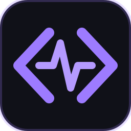

<div align="center">



# BuildDoctor

**Turn build failures into a fix plan.**

An automated diagnostic tool for JavaScript and TypeScript projects. It inspects your repository, normalizes build logs, and generates a verified repair plan without running your code.

Built by [AK-Lmn](https://github.com/AK-Lmn).

[](https://github.com/AK-Lmn/BuildDoctor/actions)
[](https://www.typescriptlang.org/)
[](https://nextjs.org/)
[](https://vitest.dev/)
[](https://github.com/AK-Lmn/BuildDoctor)

[Live App](https://build-doctor.vercel.app) • [Architecture](#architecture) • [Getting Started](#getting-started) • [Safety](#safety-and-limits)

</div>

---

## What It Does

Build failures in modern frontend stacks are often cryptic. A missing module error might come from a `tsconfig.json` path alias, broken casing, dependency mismatch, or framework config.

BuildDoctor automates this check:
1. Reads configuration files from your public GitHub repository (`package.json`, `tsconfig.json`, build configs).
2. Normalizes build logs and strips ANSI noise, secrets, and raw paths.
3. Matches errors against deterministic diagnostic rules first, then synthesizes a validated repair plan.
4. Generates copyable patches and terminal commands.

---

## How It Works

```
POST /api/diagnose
     │
     ├─ Input validation (Zod)
     ├─ Log normalization (ANSI strip, CRLF, truncation, redaction)
     ├─ GitHub API (read allowlisted config files only)
     ├─ Project detection (framework, package manager, Node version)
     ├─ Deterministic diagnostics (syntax checks, alias resolution, dependencies)
     ├─ Gemini structured synthesis (validated via Zod)
     ├─ Evidence verification (all cited files and lines confirmed)
     └─ Clean response (no secrets, zero code executed)
```

---

## Getting Started

### Prerequisites
- Node.js 20+
- Optional: `GEMINI_API_KEY` for AI synthesis
- Optional: `GITHUB_TOKEN` for higher GitHub API rate limits

### Installation

```bash
git clone https://github.com/AK-Lmn/BuildDoctor.git
cd BuildDoctor
npm install
```

Copy the environment file:
```bash
cp .env.example .env.local
```

Start the dev server:
```bash
npm run dev
```

Open [http://localhost:3000](http://localhost:3000).

---

## Development

```bash
npm run dev        # Dev server (localhost:3000)
npm run build      # Production build
npm run typecheck  # TypeScript check (tsc --noEmit)
npm run lint       # ESLint
npm run test:run   # Run all 139 deterministic tests
```

---

## Safety and Limits

BuildDoctor is designed with safety limits by default:

- **Zero code execution**: Code is only parsed and read statically. Builds are never executed.
- **Strict allowlist**: Only reads configuration and manifest files (`package.json`, `tsconfig.json`, `next.config.*`, etc.). Blocked from reading `.env*`, keys, or binary files.
- **Secret redaction**: Automatically redacts API keys, tokens, JWTs, and database URLs from logs before processing.
- **Repository fetch caps**: Maximum 50 files, 150 KB per file, and 600 KB total payload per run.

---

## License

MIT © [AK-Lmn](https://github.com/AK-Lmn)
